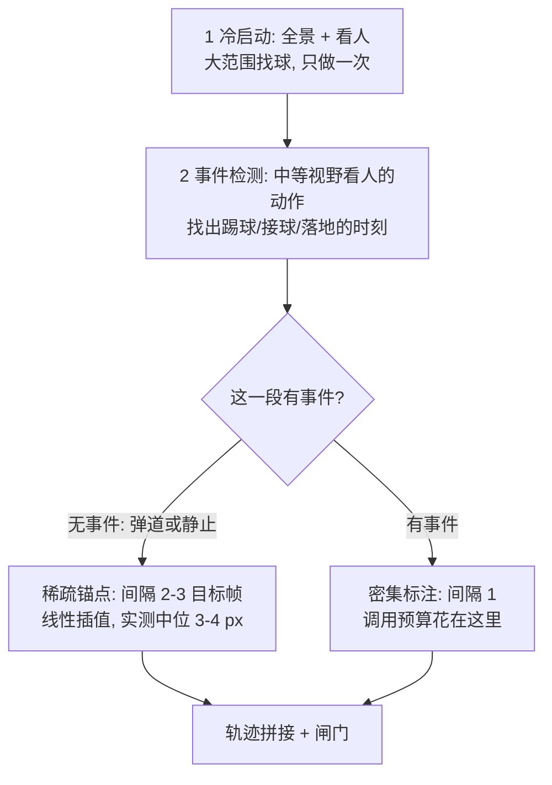
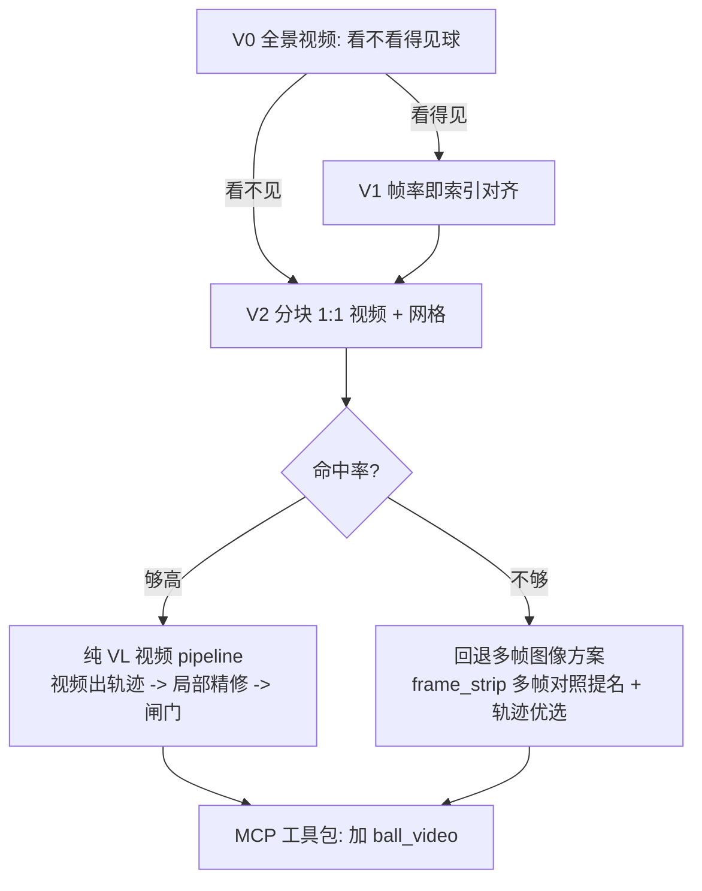

# 球标注：先测 M3 视频输入，再定 pipeline

## 一、先把手上的数说清楚

线上库（`/api/v2/stats`）：

- 人工 GT **342 帧**（worker `wangmin`），AI 入库 193 帧，GT 共 9 包
- 审核判决：**8349 帧判错、251 帧通过，帧通过率 2.9%**，包通过率 1.2%
- 但这批是 `workflow=erp_ball_v1` + `model_used=glm_flash`。**v2 + glm-4.5v 在线上一帧都还没被审过** —— 所以「正确率≈0」目前是 v1 的数，不要拿它否定 v2
- 另有 mcp-agent 提交 2 包 / 200 帧，通过 0

两个直接可用的资产：那 **8349 个已知错点**是免费的大负样本集（没有正确坐标，但「这个点错」本身就是标签）；41 个 available + 67 个 need_human 包可以拿来标测试集。

我先前那组「单帧判别力只有约 50%」的测量，量的是**本地 CV 特征**，不能外推到 VL，这一点你指出得对。下面不拿它当任何判据。

---

## 二、人工标注经验的定量版（决定视野与调用预算）

标注员（专家）的实际做法：只有一开始找球要大范围搜索，之后基本只看局部；**全程关注球周边人的动作**；平直段隔几帧自动插值；遇到人要踢球或其他交互就标得更细。

下面在 15 个 GT 包的**人工锚点**上量化（锚点是真观测，不含插值假设）。

### 插值误差 vs 锚点间隔

留一交叉：只保留每 k 个锚点，插值后在被抽掉的真锚点上量误差。

- k=2：线性 中位 3.1 / p90 15.0 px，三次 3.0 / 19.3，**90%** ≤20px
- k=3：线性 4.4 / 18.4，三次 4.4 / 42.3，82%
- k=4：线性 7.5 / 26.4，三次 8.0 / 43.5，77%
- k=6：线性 16.3 / 54.0，三次 16.7 / **207.4**，54%
- k=8：线性 23.3 / 93.7，三次 31.1 / 304.5，36%
- k=12：线性 50.7 / 221.4，三次 80.0 / **1183.8**，15%

均匀采样的安全工作点是**锚点间隔 2–3 个目标帧**（0.2–0.3 秒），间隔 4 开始劣化，≥6 崩掉。

另外：**大间隔时线性明显优于三次**（样条过冲，k=12 时 p90 炸到 1184 px）。`client/track.py` 现在锚点 ≥4 就用自然三次样条，守卫只看步速（`2×vmax`），应该按**锚点间隔**再加一条。

### 但均匀采样是错的目标

人的锚点密度随球速自适应，跨 **50 倍**：

- `260517__VID_20260517_125036_00_002`：2 锚点 / 101 帧，球全程移动 **7 px** → 间隔 99 的直线插值完全正确
- `260305__001__0167_0177`：3 锚点，全程 1 px；`260116__002__1006_1016`：4 锚点，全程 2 px
- `260108__VID_20260108_203231_001__3795_3805`：**93 锚点** / 127 帧，相邻锚点位移中位 22 / p90 70 px
- `260903__VID_20260903_214111_00_005`：43 锚点，锚点处加速度 p90 **70 px**（事件最密）

所以调用预算不该均摊。自适应判据是**加速度**：锚点处加速度中位 7–10 px、p90 27–70 px，加速度大的地方就是交互事件，也就是必须密标的地方。

### 三条硬修正

**1. 主力窗口必须装得下人。** 这是这条经验对方案最大的修正。`views.make_context_view` 的 `person_size=240.0` 是仓库自己对「一个人大小」的估计，而 v2 的主力级是 **80 px 窗**、收尾 **45 px 窗** —— 只有 1/3 和 1/5 个人。**在那个视野里根本看不到「球周边人的动作」**，而这恰恰是人工标注全程的主要依据。这就是「感受野被砍掉」的量化证据。

- 新 pipeline 的主力窗口应为 **240–480 px**（1–2 个人），不是 80 / 45
- 精修可以用小窗，但必须同时给带人的上下文图，且**判断依据以上下文图为准**。现在 `client/prompts/refine.zh.txt` 的图1 就是 context，却写着「只用来理解现在在场上哪」「**不要在这张图上选格子**」—— 上下文被降格成辅助，而人类标注员是反过来的

**2.「看人」是全程主线索，不是冷启动一级。** 原方案只在 `overview` 让模型看人。要改成每一级局部视图都带足够人体上下文，并在提示词里把「谁在控球 / 谁要踢球 / 球在谁脚下」写成**定位依据**，而不是干扰物排除清单。

**3. 静止球是主要工况，任何「必须在动」的先验都危险。** 3/15 包球全程移动 ≤7 px（20%）。我先前提过在轨迹优选里加「静止抑制」压掉不动的候选 —— 那会正好杀掉真球，**这条撤掉**。静止球靠 `enhance.residual` 的背景差项 `|I_t − B|` 仍然可见；`client/prompts/confirm9.zh.txt` 已经写对了（「球不一定在动…停在球员脚下也算有球」），新提示词要继承。运动模型必须是混合的（静止段 + 弹道段），不能用单一速度先验。

### 由此得出的采样策略



调用预算于是从「100 帧 × 2.9 次」变成「冷启动几次 + 事件检测几次 + 事件段密标 + 平直段稀疏锚点」。按实测锚点分布，一包 33–93 个锚点里真正需要密标的只是加速度大的那一小段。

---

## 三、第一步：MiniMax-M3 视频输入阶梯实验

### 接口事实（已查官方文档）

`POST /v1/chat/completions` 的 content 里用 `video_url` 块：

```json
{"type": "video_url", "video_url": {
  "url": "https://... | data:video/mp4;base64,... | mm_file://{file_id}",
  "detail": "low|default|high", "fps": 1, "max_long_side_pixel": 672}}
```

- **`fps` 范围只有 0.2–5**
- `detail` 控制抽帧分辨率，`max_long_side_pixel` 限制单帧长边
- URL / base64 视频 ≤ **50 MB**，Files API ≤ 512 MB，请求体 ≤ 64 MB
- 官方评测口径：1 fps、最多 512 帧、单帧长边 336–1008 px
- M3 的 `thinking` **省略时默认开启**，`{"type":"disabled"}` 可关。`client/providers.yaml` 现在给 minimax 关了 —— 视频轨迹推理上开着可能更好，作为变量测

### 两条硬约束，决定实验必须这么设计

**约束 1：分辨率。** ROI 是 4016×662（有的包 4016×2072），球实测等效直径 17.7 px。压到长边 1008 是 4 倍降采样，球剩 **4.2 px**；公网 thumb 已经是 1280×208，球剩 **5.4 px**。**全景视频很可能根本看不见球。** 这不是要绕过的麻烦，这是 V0 要第一时间测掉的事 —— 测出来是「看不见」，V2 分块就是唯一出路，且立刻知道。

**约束 2：fps 上限 5，而目标帧是 10 fps**（30 fps 源、step=3）。所以视频通道**没法逐目标帧作答** —— 除非把**帧率当索引**：把 100 个目标帧重编成 1 fps（100 秒）或 5 fps（20 秒）的视频，M3 按 fps=1 / fps=5 抽帧就和目标帧一一对齐，它说「第 37 秒」就等于第 37 个目标帧。`producer/derive.py` 的 `decimate_clip` 已经有 `select='not(mod(n,decim))'` + `setpts=N/FRAME_RATE/TB` 的写法，加个 `-r` 就是。

### 阶梯（每级先确认「还看不看得见球」，再往下）

**V0 分辨率体检 —— 最先做，它决定后面还有没有**

- 输入：公网 `https://ballgt.yinger650.com/thumb/{pid}/clip.mp4`（已验证 200，1280×208 / 300 帧 / 121 KB）和 `dog.mp4`（3.6 MB）；再用本地全分辨率 `clip.mp4`（13.7–29 MB，**有的包 64 MB 超 50 MB 上限，要走 Files API**）走 base64 对照
- `fps=1`、`max_long_side_pixel` 拉到最大
- 问最粗的问题：这段里有没有一颗足球在动？它大致在画面左/中/右哪一段？从哪往哪飞？
- 判据：方向和大致区段对不对（有 GT 可核）。连方向都说不对 → 全景视频这条路堵死，直接转 V2

**V1 帧率即索引**

- 把目标帧重编成 1 fps / 5 fps 视频，验证 M3 的时间戳能不能稳定翻回目标帧号
- 这一级只验索引对齐，不验精度

**V2 分块保分辨率 —— 全景看不见时的正路**

- ROI 横切约 6 块 **720×662，1:1 不降采样**，球保持 17 px，每块编成 1 fps 视频。体积很小，直接 base64
- 也测「先用 `scan_time.jpg` 定位轨迹带，只对相关的 1–2 块出视频」，把 6 次调用压到 2 次
- 通道对比：raw 视频 / dog 视频 / 两个都给
- 烧网格 + 帧号进视频，要它输出 `[{t, cell}]` 序列，复用 `GridView` 的格子→坐标映射

**V3 输出形态与 thinking**

- 轨迹描述（方向/踢球事件）vs 格子序列 vs 关键帧坐标
- `thinking` 开 / 关

### 要量什么

在人工 GT 上算命中率（误差 ≤20 px）、中位误差、**null 率**（精度优先意味着要它敢说没有），并在那 8349 个已知错点上量误报。同时记 token、延迟、**每包成本** —— 视频 token 很贵，1 fps × 100 帧的账要先算出来。

### 要写的代码

- `client/vlm.py` 加 `video_url` content part（现在只有 base64 `image_url`，见 `_part` 附近），带 `detail` / `fps` / `max_long_side_pixel`；大文件走 Files API 上传拿 `mm_file://`
- `scripts/probe_video.py` 新建，跑上面四级，输出照 `scripts/smoke_vlm.py` 的形状（它已经有「裁切中心按上一级典型误差随机偏移」「逐家逐帧打分」「打印结论」这套骨架，直接抄）
- `producer/derive.py` 加「按目标帧重编成 N fps」的辅助

---

## 四、测试集

### 先说一个比样本量严重得多的问题：ROI 换代了

| | ROI | thumb 高 |
|---|---|---|
| 已有 6 包人工 GT | 全是 **~4016×660**（扁条） | 208–211 |
| 35 个 available 待标包 | 全是 **~4016×2080** | 648–706 |

面积差 **3.1 倍**。`docs/标注编排设计.md` 写着 ROI 要「确保球场完整 + 预留天空空间标注高球」—— 高 ROI 是后来为高抛球加的。所以已有 GT 和现在的生产包**不是同一个分布**，我先前所有测量都在扁 ROI 上做的，不一定能迁移。这比「3 包不够」严重，测试集必须是高 ROI。

### 白捡的 3 包

`gt/` 下其实有 **6 包**人工 GT（592 帧 / 580 可见），而且**全部在 `acp/` 下已解码**。我先前只用了 3 包，是因为只有那 3 包在 `work/` 下。把测量脚本的默认包集从 `work/` 扩到 `acp/` 就白得一倍数据，不用标注。

### 建议标 6 包（600 帧，约 1–1.5 小时）

实测已有 GT 的 `label_span_sec` 是 409 / 414 / 666 秒，**约 7–11 分钟一包**（另两包 8 万多秒是跨天中断的时间跨度，不是工时）。

按两个免标注代理指标分层（用公网 thumb 算的：一帧灰度均值当光照，`scan_dog` 上 >60 的像素占比当杂乱度）：

- `260507__007__0042_0052` —— 亮度 **30.8**（全场最暗），杂乱 6.7%
- `260517__VID_20260517_125036_00_002__0784_0794` —— 亮度 **133.0**（最亮，12:50 白天），杂乱 36.7%
- `260507__008__0375_0385` —— 杂乱 **42.1%**（全场最乱），亮度 70.5
- `260116__002__1006_1016` —— 杂乱 **5.4%**（全场最干净），亮度 83.3。且 260116 组里已有一包扁 ROI 的 GT，可以用它隔离「ROI 换代」的影响
- `260903__VID_20260903_214111_00_005__0189_0199` —— 夜场 21:41，亮度 90.5 / 杂乱 21.3%（中档代表）
- `260806__VID_20260806_063708_00_005__0817_0827` —— 清晨 **06:37**（低角度晨光、长影子），亮度 83.3 / 杂乱 27.4%

覆盖亮度 30.8→133.0、杂乱 5.4%→42.1%，5 个不同比赛日、6 个不同 stem、三个时段（晨 / 午 / 夜）。

跳过 `260611__VID_20260611_203153_00_001__0963_0973`：它 `n_targets=200`，是双倍长包。

「彩迹跨度」那个球速代理没用（35 个包全是 1.0，因为球员到处动都会在 `scan_time` 上留彩色像素），所以球速只能标完才知道。

### 纪律

**测试集不进调参。** 门限、提示词、几何都在已有那 6 包上扫，这 6 包只跑最终确认。

### 怎么标指定的包

`/api/v2/lease` 支持 `packet_id`（`server/app.py` 的 `want` → `db.pick_packet(want_packet=...)`），本地人工站也一路透传（`client/manual.py:266` → `:294`），前端 claim 的 body 里带 `packet_id`（`server/static/js/manual_home.js:83`）。

```bash
./venv/bin/python -m client.manual --server https://ballgt.yinger650.com --worker wangmin
# 打开 http://127.0.0.1:8780/ ，在「待标注」列表里点上面这 6 个包，或直接：
curl -s http://127.0.0.1:8780/start -H 'Content-Type: application/json' \
  -d '{"kind":"human","packet_id":"260507__007__0042_0052"}'
```

### 对 V2 分块设计的影响

高 ROI 是 4016×2072（aspect 1.94），横切三段不够了 —— 一块 720×2072 的长边仍是 2072，还是会被降采样。要改成**二维分块**（如 1008×1008，约 4×2=8 块），或者先用 `field.py` 的球场边界把大片天空/看台裁掉再分块。

---

## 五、视频路线通与不通的分叉



不管哪条分叉，下面这些都要做，所以可以并行推进：

- **`scripts/export_review_negatives.py`** —— 把 8349 个判错帧导出成真实负样本集。现在 `client/verify.py --stats` 用的是人造的 40–150 px 偏移，真实失败模式的分布不一样，`verify.gate` 该按真数据重定
- **堵 MCP 免审通道** —— `ball_submit` 现在走 `source="human"` **免审入库**（`client/agent_core.py`）。mcp-agent 已经这样进了 2 包 200 帧、通过率 0。要么改成进 `pending` 走审核，要么只允许提交过了本地闸门的帧
- **MCP 工具包** —— 详见下节
- **文档漂移** —— `docs/agent-annotator.md` 工具表缺 `ball_scan`、写「8 个」实际 9 个；`time_grid` 描述写 160 实际 `views.TIME_GRID_SIZE=240`；MCP crop 默认 8×8 而 `SKILL.md` 写 6×6

---

## 六、Codex MCP 工具包

现状：stdio、纯标准库、按行 JSON-RPC，实际 **9 个**工具，数据面在 `client/agent_core.py` 的 `AgentSession`，`client/mcp_server.py` 只是薄封装 —— 改造要动 `agent_core.py`。现在教的是逐帧 `480→80→45`，一包 300+ 次调用。

保留：`ball_lease` / `ball_status` / `ball_release` / `ball_submit`（加闸门）

新增：

- `ball_plan()` —— 目标帧列表、ROI 尺寸、球场边界、每帧状态 + 下一步建议（哪几段没覆盖），codex 不用自己记进度
- `ball_video(segment, fps, layers)` —— **视频路线通了就是主力**：按分块出 1 fps 视频（base64 或 `mm_file://`），codex 直接把它交给自己的视觉通道
- `ball_overview()` —— 全景三段 1:1 raw 粗格子
- `ball_scan()` —— `scan_time` 彩图 + `scan_dog`（已有，接新口径）
- `ball_strip(center, size, zoom, frames, layers)` —— 同窗多帧横排带格子，视频不通时的主力
- `ball_nominate(frame_idx, view_id, cells[{cell, conf, note}])` —— 提名候选，可多可空，**返回每个候选的本地 `verify` 明细分**（zone / dog / rgb + 理由）。这个闭环目前完全没暴露
- `ball_fit()` —— 本地轨迹拟合，返回 top-K + 每帧残差 + 残差最大的段。零调用、可反复跑
- `ball_follow(track_id)` / `ball_commit(track_id, frames)`（拒绝未过门的帧并说明原因）/ `ball_absent(frames)`

`skills/ball-label/SKILL.md` 重写。注意 **Codex 不读 `skills/` 目录**，要靠 `AGENTS.md` + `~/.codex/config.toml`，见 `skills/ball-label/adapters/codex.md`。

---

## 七、关于「VL 不行小模型更不行」

这个推论方向可能是反的，记在这里免得后面走错：

- VL 的视觉编码器会降采样。ROI 4016 宽、球 17 px = 宽度的 **0.4%**，小目标上的劣势是架构性的，不是「模型不够聪明」
- 专用高分辨率小模型（WASB / 高分辨率 FPN）在小球检测上通常强于通用 VL。文档记着 WASB / FootAndBall 在这批数据上失手，但那是因为**静态单帧**，不是因为模型小 —— `enhance.py` 的模块头也是这么写的
- 更要紧的是：**标注 pipeline 允许用最终模型用不到的东西** —— 多帧、DoG、全局轨迹、人工复核。GT 的活儿是把答案挖出来，不是模拟推理

所以 V0–V3 测不通不代表小模型不行；但测通了，确实是「这批数据的信息量够」的强证据。

---

## 八、先做哪一步

**V0 分辨率体检。** 它只需要给 `client/vlm.py` 加一个 `video_url` 块，输入用已经验证可达的公网 thumb URL，问一个最粗的方向题。花不到一小时、几次调用，就能知道全景视频里球还看不看得见 —— 这是分叉点，`fps`/分块/提示词/成本的所有后续设计都挂在它的结果上。

你那边可以并行开始标测试集。
